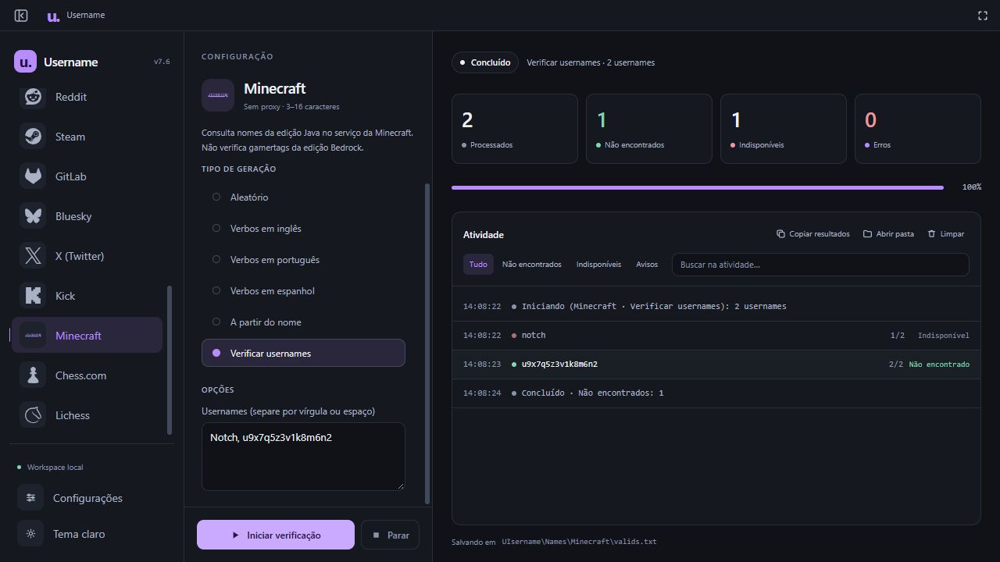

<div align="center">
  

  <h1>UIsername</h1>

  <p><strong>Find your name. Build your identity.</strong></p>
  <p>A free desktop username generator and checker with a minimal interface.</p>

  <p>
    
    
    
    
    <a href="https://github.com/stagedivepov/UIsername/actions/workflows/build-windows.yml"></a>
  </p>

  <p>
    <a href="https://github.com/stagedivepov/UIsername/releases/latest"><strong>Download for Windows</strong></a>
    &nbsp;·&nbsp;
    <a href="#features">Features</a>
    &nbsp;·&nbsp;
    <a href="#platforms">Platforms</a>
    &nbsp;·&nbsp;
    <a href="https://github.com/stagedivepov/UIsername/issues">Report a bug</a>
    &nbsp;·&nbsp;
    <a href="#contributing">Contribute</a>
  </p>
</div>

---

## About

**UIsername is a solo project**, created and developed by one person.

It started with the realization that many simple but important tools are only available for a fee. The mission is to end the need to pay for these services by offering a free, accessible alternative for generating and checking usernames.

One interface brings together name generation, platform checks, session history, and statistics. The application is free; some platforms may require your own credentials or access to their APIs.

## Download

**[Download the latest release →](https://github.com/stagedivepov/UIsername/releases/latest)**

| File | Purpose |
| --- | --- |
| `UIsername.exe` | Ready-to-run application for Windows 10/11, 64-bit. |
| `UIsername-Windows-x64-v2.0.zip` | The same executable with a quick-start guide and vocabulary credits. |
| `SHA256SUMS.txt` | File hashes for checking the integrity of release downloads. |

1. Download and open `UIsername.exe`.
2. Choose your language on first launch.
3. Select a platform and configure generation or checking.
4. Start the session and follow the results.

**You do not need to install Python to use the executable.** The desktop window uses Microsoft WebView2. If it cannot start, the app attempts to open its interface in your default browser. Platform checks require an internet connection; local name generation works offline.

## Interface



## Features

### Username generation

- Random names, verbs, two-verb combinations, and suggestions based on your name.
- Optional numbers, separators, prefixes, and suffixes.
- Checking lists of usernames.
- An advanced generator with patterns, rules, presets, and favorites.
- Built-in dictionaries shared by the standard and advanced generators:

| Generation language | Entries |
| --- | ---: |
| English | 11,425 verbs and verb expressions |
| Portuguese | 5,465 verbs |
| Spanish | 8,149 verbs |
| **Total** | **25,039** |

### Checking and history

- Identity Checker for querying usernames across multiple platforms.
- Explicit states for confirmed results, inconclusive responses, rate limits, errors, and required authentication.
- Session history with archive, restore, and delete actions.
- Local statistics, charts, and CSV/JSON exports.
- Copying and exporting results, depending on the selected tool.
- Cancellation confirmation enabled by default.

### Appearance and preferences

- Seven interface languages: English, Portuguese, Spanish, Simplified Chinese, Japanese, Russian, and French.
- Light, Dark, Starry Sky, Dracula, Nord, Catppuccin Mocha, Tokyo Night, and Rosé Pine, plus system appearance.
- Shooting stars and support for the system's reduced-motion preference.
- Custom window controls, fullscreen with `F11`, and a startup window-mode preference.
- Collapsible sidebar and typo-tolerant platform search.
- Automatically saved settings.
- Adjustable intervals in milliseconds: **1000 ms = 1 second**. Platform minimum delays are respected.
- Optional batch requests on compatible platforms.
- Optional HTTP proxies, `.txt` import, and a connection choice before starting on compatible platforms.

## Platforms

UIsername includes checking modules for these 18 platforms:

| | | |
| --- | --- | --- |
| Roblox | GitHub | Discord |
| Twitch | TikTok | Instagram |
| YouTube | Telegram | PlayStation |
| Reddit | Steam | GitLab |
| Bluesky | X (Twitter) | Kick |
| Minecraft Java Edition | Chess.com | Lichess |

**Each service has different checking rules.** Some modules check whether a profile exists; others can obtain an availability response. A missing profile does not guarantee that a username can be registered.

Twitch, Steam, X, and Kick require your own credentials. Some other integrations accept optional credentials. PlayStation support is experimental. API limits, reserved names, and service restrictions may affect results.

Listed platforms are application integrations, without any implication of partnership or endorsement.

## Data and privacy

Application data belongs to the account using the app. On Windows:

```text
%LOCALAPPDATA%\UIsername
├── settings.json          # Preferences
├── proxies.txt            # User-provided proxies
├── activity.sqlite3       # Local history and statistics
├── crash.log              # Error logs
└── Names/
    └── <platform>/
        └── valids.txt     # Saved results
```

The directory and files are created as needed. Tokens provided to the app remain in memory; proxy lists are saved locally. During platform checks, queried usernames are sent to the corresponding services.

Personal settings, proxies, results, and build output are excluded from the repository by `.gitignore`.

## Run from source

Requires **Python 3.10+**. The distributed executable targets Windows x64.

```powershell
git clone https://github.com/stagedivepov/UIsername.git
cd UIsername
python -m venv .venv
.\.venv\Scripts\python.exe -m pip install -r requirements.txt
.\.venv\Scripts\python.exe app.py
```

The interface uses HTML, CSS, and JavaScript. The desktop window uses pywebview, network checks use Requests, and session storage uses SQLite.

## Build for Windows

After installing dependencies:

```powershell
.\.venv\Scripts\python.exe -m PyInstaller --noconfirm UIsername.spec
.\.venv\Scripts\python.exe scripts/package_release.py
```

The executable is generated at `dist/UIsername.exe`. Distribution files are written to `release/`.

### GitHub Actions

The [Build Windows](https://github.com/stagedivepov/UIsername/actions/workflows/build-windows.yml) workflow is configured to run tests, build the executable, and upload distribution artifacts. It supports manual runs and pushes of `v*` tags; tag pushes also prepare a draft Release.

Check the **Actions** tab for actual execution results. A configured workflow does not establish that every external platform integration has been verified.

## Documentation

- [Publishing and Releases](PUBLISHING.md)
- [Advanced generator, Identity Checker, and analytics](docs/ADVANCED-SYSTEMS.md)
- [Vocabulary sources](docs/VERB-VOCABULARY.md)
- [Version 2.0 release notes](docs/CHANGES-v2.0.md)
- [Icon and component credits](THIRD_PARTY_NOTICES.md)
- [Vocabulary credits and licenses](ui/third-party-vocabulary.txt)

Some technical documentation is currently available in Portuguese.

## Contributing

Suggestions, translations, fixes, and new integrations are welcome.

1. Check the existing [Issues](https://github.com/stagedivepov/UIsername/issues).
2. Describe the problem or proposal with context.
3. To contribute code, create a fork and a branch for your change.
4. Open a [Pull Request](https://github.com/stagedivepov/UIsername/pulls) explaining what changed and how it was verified.

When reporting a bug, include the app version, Windows version, affected platform, and steps to reproduce. Remove tokens, passwords, and private proxies from screenshots and logs.

## Third-party credits and licenses

The dictionaries include data from **WordNet**, **fserb/pt-br**, and **ian-hamlin/verb-data**, with their own attribution and licensing requirements. Platform icons and other components also have their respective credits in the documentation linked above.

---

<div align="center">
  <strong>A solo project accessible to everyone.</strong><br>
  <sub>If UIsername helped you, consider starring the repository and sharing the project.</sub>
</div>
